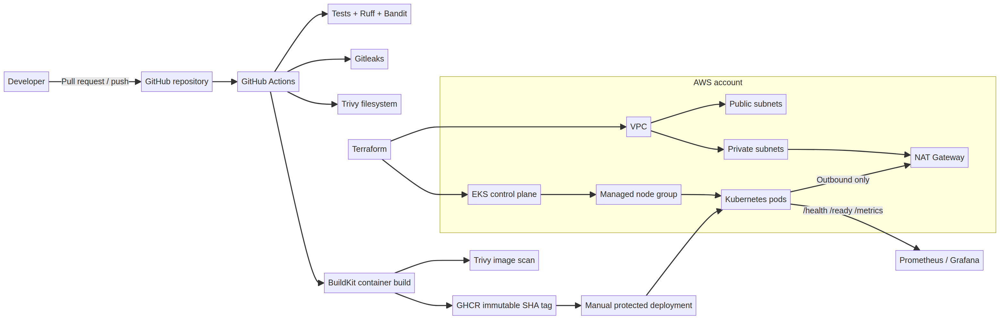
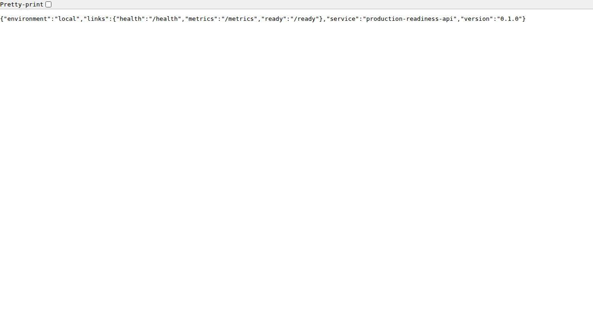

# DevOps Production Readiness Lab

[](https://github.com/Sunanda-devops/devops-production-readiness-lab/actions/workflows/ci-cd.yml)

A working AWS DevOps reference implementation that takes a small Flask service through testing, security scanning, container packaging, GHCR publishing, Terraform infrastructure, and Kubernetes deployment. The repository is designed as a portfolio-quality lab: it is runnable locally without AWS, while the cloud path remains explicit, reviewable, and safe to apply deliberately.

## Architecture at a glance



The delivery path is:

```text
Developer -> GitHub -> GitHub Actions -> tests and security gates -> GHCR -> protected EKS deployment
```

Terraform provisions the AWS foundation. Kubernetes runs the application with health probes, resource controls, and a restricted security context. Prometheus-compatible metrics are available at `/metrics`.

See the editable diagram sources in [`docs/architecture.mmd`](docs/architecture.mmd) and [`docs/security-controls.mmd`](docs/security-controls.mmd).

## What is actually implemented

- Flask service with `/`, `/health`, `/ready`, `/metrics`, request IDs, structured 404 responses, and operational logging.
- Five automated tests covering service metadata, health, readiness, metrics, and error tracing.
- Ruff linting and Bandit static security analysis.
- Multi-stage, non-root Docker image with a health check.
- Hardened Docker Compose profile with read-only filesystem, dropped capabilities, and `no-new-privileges`.
- Terraform modules for a VPC, public/private subnets, NAT Gateway, EKS control plane, managed node group, and IRSA/OIDC.
- Kubernetes namespace, ConfigMap, Deployment, Service, PodDisruptionBudget, probes, resource limits, and optional TLS Ingress.
- GitHub Actions jobs for tests, Terraform validation, Gitleaks, Trivy filesystem scanning, container build, Trivy image scanning, GHCR publishing, and protected manual deployment.
- Helm packaging, a Jenkins pipeline equivalent, Prometheus ServiceMonitor guidance, and an operations/backup recovery pattern.
- Documentation for installation, configuration, troubleshooting, security review, and contribution standards.

## Service screenshot



The screenshot is captured from the locally running service. Use the commands below to reproduce it.

## Quick start

### Prerequisites

For the local application path, install Python 3.12+ and Git. Docker Engine with Compose v2 is optional. Terraform, AWS CLI, kubectl, and Helm are only required for the AWS/EKS path.

### Run and test locally

```bash
git clone https://github.com/Sunanda-devops/devops-production-readiness-lab.git
cd devops-production-readiness-lab
cp .env.example .env
python3 -m venv .venv
. .venv/bin/activate
pip install -r requirements-dev.txt
make check
python -m app.app
```

Open `http://localhost:8080/`, or check the operational endpoints:

```bash
curl -i http://localhost:8080/health
curl -i http://localhost:8080/ready
curl http://localhost:8080/metrics
```

### Run with Docker Compose

```bash
cp .env.example .env
docker compose up --build
curl http://localhost:8080/health
docker compose down
```

The image runs as the unprivileged `app` user. Local `.env` files, Terraform state, and plans are ignored by Git.

## Configuration

The main application settings are:

| Variable | Default | Purpose |
|---|---|---|
| `APP_VERSION` | `0.1.0` | Version reported by `/`. |
| `ENVIRONMENT` | `local` | Environment label reported by `/`. |
| `PORT` | `8080` | Local listening port. |
| `LOG_LEVEL` | `INFO` | Application log level. |

See [`docs/configuration.md`](docs/configuration.md) for the complete configuration reference and CI/CD settings.

## Helm and Jenkins alternatives

The same hardened workload can be rendered and installed with Helm:

```bash
helm lint helm/production-readiness-api
helm template production-readiness-api helm/production-readiness-api
helm upgrade --install production-readiness-api helm/production-readiness-api \\
  --namespace production-rollout --create-namespace \\
  --set image.tag=<immutable-commit-sha>
```

[`Jenkinsfile`](Jenkinsfile) provides an equivalent Jenkins path for teams that use Jenkins. It runs tests, Ruff, Bandit, Gitleaks, Docker build, and Trivy image scanning; registry publishing and deployment should be added through Jenkins credentials and protected stages in the target environment.

[`monitoring/servicemonitor.yaml.example`](monitoring/servicemonitor.yaml.example) integrates the `/metrics` endpoint with the Prometheus Operator. See [`docs/operations.md`](docs/operations.md) for dashboards, alerting, logging, and backup/restore patterns.

## Terraform and EKS

Terraform uses version-constrained AWS modules to create a VPC and EKS platform. Worker nodes run in private subnets, the EKS public API endpoint is disabled by default, and IRSA is enabled for pod-level AWS identity.

Validate the configuration without provisioning resources:

```bash
cd terraform
terraform init -backend=false
terraform fmt -check -recursive
terraform validate
terraform plan -var-file=terraform.tfvars.example
```

To provision an environment, copy `terraform.tfvars.example` to an untracked `terraform.tfvars`, review a saved plan, and apply it only after confirming AWS account, cost, IAM, network, encryption, and retention requirements. The modules create paid resources.

```bash
terraform plan -out=tfplan
terraform apply tfplan
```

Use an encrypted remote backend with locking for shared or production state. Never commit state, plans, credentials, or kubeconfig files.

## CI/CD pipeline

Every pull request and push runs tests, linting, Bandit, Terraform validation, Gitleaks, and Trivy filesystem scanning. The container job builds the image and scans the same immutable commit-SHA tag that is published on `main`:

```text
ghcr.io/sunanda-devops/production-readiness-api:<commit-sha>
```

The optional deployment job is manual and protected by a `production` environment. Prefer GitHub OIDC and short-lived AWS credentials for production; the lab documents `KUBE_CONFIG_B64` only as a temporary fallback.

## Troubleshooting

Common scenarios are documented in [`docs/troubleshooting.md`](docs/troubleshooting.md), including:

- Python import and virtual-environment problems.
- Port conflicts.
- Docker daemon failures.
- Gitleaks and Trivy findings.
- Terraform provider initialization errors.
- EKS scheduling and readiness failures.

## Security posture and next steps

The repository starts with no embedded credentials, secret scanning, vulnerability scanning, non-root containers, restricted Kubernetes pods, private worker subnets, disabled public EKS API access, and health/readiness contracts.

Before production, complete the actions in [`SECURITY_REVIEW.md`](SECURITY_REVIEW.md): integrate a secret manager, use OIDC-based deployment, inspect generated security-group rules, add network policies and TLS ingress, enable centralized logs and alerts, sign images, enforce admission policies, and test backup/disaster-recovery procedures.

## Repository guide

- [`docs/installation.md`](docs/installation.md) — local, Docker, Terraform, and EKS setup.
- [`docs/configuration.md`](docs/configuration.md) — environment variables and CI/CD settings.
- [`docs/troubleshooting.md`](docs/troubleshooting.md) — failure scenarios and recovery steps.
- [`docs/resume-alignment.md`](docs/resume-alignment.md) — what the latest resume is evidenced by this repository and what belongs to other projects.
- [`docs/operations.md`](docs/operations.md) — observability and recovery guidance.
- [`docs/architecture.mmd`](docs/architecture.mmd) — editable architecture diagram source.
- [`docs/security-controls.mmd`](docs/security-controls.mmd) — editable security-control diagram source.
- [`SECURITY_REVIEW.md`](SECURITY_REVIEW.md) — findings and production hardening plan.
- [`CONTRIBUTING.md`](CONTRIBUTING.md) — contribution and review workflow.
